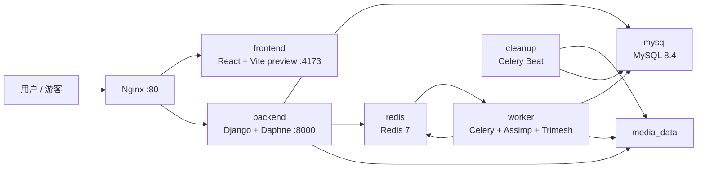

# Model Desk 技术实现说明

本文档记录 Model Desk 当前代码中的技术实现、模块职责、运行时边界和
主要角色。内容以仓库现状为准，用于开发维护、问题定位和后续功能扩展。

## 1. 系统定位

Model Desk 是一个本地优先的 3D 模型转换与预览平台。系统将模型上传、
格式转换、外部资源关联、材质预览、模型统计、任务进度和文件生命周期
管理整合在同一个网页应用中。

系统提供两个转换运行时：

| 运行时 | 执行位置 | 主要用途 | 数据边界 |
| --- | --- | --- | --- |
| 服务端运行时 | Docker Compose 中的后端与 Celery Worker | 完整格式转换、用户隔离、任务历史 | 数据库和媒体卷持久化；转换产物限时保留 |
| 浏览器运行时 | 用户浏览器的 Web Worker | 游客模式和轻量本地转换 | 仅当前页面会话内存，不写入应用持久化存储 |

两个运行时使用同一个前端和同一个 `80` 端口入口。游客模式只能进入浏览器
运行时；登录用户默认进入服务端运行时，并可以切换到浏览器运行时。

## 2. 角色定义

### 2.1 用户角色

#### 登录用户

登录用户使用邮箱格式作为用户名。登录后可以：

- 使用服务端运行时完成完整转换流程；
- 选择浏览器运行时进行本地会话转换；
- 查看当前账户隔离的任务历史和源文件；
- 下载转换产物；
- 删除任务或源文件；
- 为模型附加贴图和外部资源文件。

#### 游客

游客不创建临时后端账户，直接进入浏览器运行时。游客不能访问服务端任务
历史和源文件库，也不会产生后端任务记录。

游客模式的限制由前端运行时策略控制：

- 模型与附件合计不超过 `100 MiB`；
- 仅开放浏览器已实现的输出格式；
- 结果只保留在当前页面会话中；
- 页面刷新、离开页面或切换到服务端运行时后，浏览器任务数据会被清除。

### 2.2 系统组件角色

| 组件 | 技术角色 | 主要职责 |
| --- | --- | --- |
| Nginx | 统一入口和反向代理 | 对外暴露 `80` 端口，转发页面、REST、WebSocket 和媒体请求 |
| React 前端 | 交互编排层 | 管理认证状态、运行时切换、待确认任务、任务队列、历史和预览 |
| Three.js 预览器 | 模型可视化层 | 加载模型、显示材质、相机控制、线框和模型统计 |
| 浏览器运行时 | 本地转换执行层 | 在 Web Worker 中解析模型并导出受限格式 |
| Django REST API | 业务接口层 | 认证后的文件、任务、源文件、产物和格式能力接口 |
| Daphne/ASGI | 异步 Web 服务层 | 提供 Django HTTP 请求和 Channels WebSocket |
| Django Channels | 实时消息层 | 将 Celery 任务进度通过 Redis 推送到前端 |
| Celery Worker | 异步任务执行层 | 调用 Assimp、准备场景、分析模型和保存产物 |
| Assimp CLI | 格式转换引擎 | 在服务端执行跨格式转换 |
| Trimesh | 模型分析引擎 | 计算三角面数量和模型包围盒尺寸 |
| Redis | 消息与短期状态层 | Celery broker/result backend、Channels channel layer、验证码存储 |
| MySQL | 元数据持久化层 | 保存用户、源文件、任务、附件和生命周期字段 |
| `media_data` | 文件存储层 | 保存源文件、任务附件、临时转换产物和预览文件 |
| Celery Beat | 生命周期调度层 | 周期性清理过期的转换产物和预览文件 |

## 3. 部署拓扑



`docker-compose.yml` 当前包含以下服务：

- `mysql`：MySQL 8.4，使用 `mysql_data` 卷。
- `redis`：Redis 7 Alpine，作为消息代理和 Channels 后端。
- `backend`：构建 `backend/Dockerfile`，先执行 `python manage.py migrate`，
  再由 Daphne 启动 ASGI 应用。
- `worker`：使用同一后端镜像运行 Celery Worker，默认并发数由
  `CONVERTER_CONCURRENCY` 控制，默认值为 `2`。
- `cleanup`：使用同一后端镜像运行 Celery Beat。
- `frontend`：构建 React/Vite 前端，生产预览服务监听容器内部 `4173`。
- `nginx`：使用 Nginx 1.27 Alpine，对外映射主机 `80` 端口。

Nginx 路由：

| 路径 | 目标 |
| --- | --- |
| `/api/` | Django REST API |
| `/ws/` | Django Channels WebSocket |
| `/media/` | Django 媒体文件访问 |
| 其他路径 | 前端 Vite 预览服务 |

## 4. 后端实现

### 4.1 Django 应用结构

后端位于 `backend/`：

```text
backend/
├── config/
│   ├── settings.py       # Django、数据库、认证、Redis、Celery 配置
│   ├── urls.py           # /api/ 总路由
│   ├── asgi.py           # HTTP + WebSocket ASGI 入口
│   └── celery.py         # Celery 应用初始化
├── converter/
│   ├── models.py         # 源文件、任务、附件数据模型
│   ├── views.py          # 文件和任务 REST API
│   ├── serializers.py    # REST 输出和临时资源 URL
│   ├── auth_views.py     # 注册、登录、验证码
│   ├── consumers.py      # 任务进度 WebSocket
│   ├── conversion.py     # Assimp 转换和场景准备
│   ├── tasks.py          # Celery 转换与清理任务
│   ├── lifecycle.py      # 删除、引用保护、物理文件释放
│   └── migrations/       # 数据库迁移
└── manage.py
```

### 4.2 数据模型

#### `SourceFile`

代表用户上传的原始模型文件：

- 使用 UUID 作为主键；
- 通过 `owner` 关联 Django 用户；
- 保存原始文件名、扩展名、MIME 类型和文件大小；
- 保存 SHA-256 内容摘要；
- 文件保存到 `media/sources/`；
- 同一用户的 `sha256` 唯一，实现用户范围内的源文件去重；
- 被任务引用时不会因单个任务删除而立即删除。

#### `ConversionTask`

代表一次具体的转换请求：

- 使用 UUID 作为主键；
- 关联用户和 `SourceFile`；
- 保存目标格式、任务状态和进度；
- 状态为 `queued`、`running`、`succeeded`、`failed` 或 `canceled`；
- 保存转换产物、预览文件和产物类型；
- 保存输入组合哈希 `input_hash`，用于复用相同模型及附件的转换结果；
- 保存三角面数、包围盒尺寸、错误信息和 Worker 日志；
- 保存创建、开始、完成时间；
- 保存 `artifact_expires_at`，用于 10 分钟后清理产物。

`source_file` 使用 `PROTECT` 删除策略。任务删除由生命周期模块显式处理，
避免源文件被仍存在的任务意外删除。

#### `TaskAsset`

代表某个任务附加的资源：

- 贴图类型：`base_color`、`normal`、`roughness`、`metallic`、`ao`、
  `emissive`；
- 外部资源类型：`resource`，用于 OBJ 的 MTL、GLTF 的 BIN 或外部图片；
- 保存原始文件名、大小、SHA-256 和实际文件；
- 同一个任务内不允许重复的原始文件名；
- 随任务删除。

### 4.3 REST API

默认 REST 权限为 `IsAuthenticated`，认证使用 Simple JWT。当前 API 包括：

| 方法 | 路径 | 用途 |
| --- | --- | --- |
| `GET` | `/api/auth/captcha/` | 获取注册验证码图片和验证码 ID |
| `POST` | `/api/auth/register/` | 使用邮箱、强密码和验证码注册 |
| `POST` | `/api/auth/login/` | 邮箱登录并获取 JWT |
| `POST` | `/api/auth/refresh/` | 刷新访问令牌 |
| `GET` | `/api/auth/me/` | 获取当前用户 |
| `GET` | `/api/formats/` | 获取服务端格式能力 |
| `POST` | `/api/files/upload/` | 上传一个源模型和可选附件，创建任务 |
| `GET` | `/api/files/` | 查询当前用户的源文件 |
| `GET` | `/api/files/<source_id>/` | 查询源文件及关联任务 |
| `DELETE` | `/api/files/<source_id>/` | 确认并删除源文件及其关联任务 |
| `GET` | `/api/tasks/` | 查询当前用户的任务历史 |
| `GET` | `/api/tasks/<task_id>/` | 查询单个任务 |
| `DELETE` | `/api/tasks/<task_id>/` | 删除单个任务 |
| `POST` | `/api/tasks/<task_id>/cancel/` | 取消排队中或执行中的任务 |
| `POST` | `/api/tasks/<task_id>/retry/` | 从失败或取消任务创建新任务重试 |
| `GET` | `/api/tasks/<task_id>/artifact/` | 下载转换产物 |
| `GET` | `/api/tasks/<task_id>/preview/` | 获取临时 `preview.glb` |

所有任务、源文件和资源查询都附带当前用户条件，实现用户级隔离。

### 4.4 WebSocket 实时进度

任务 WebSocket 地址：

```text
/ws/tasks/<task_id>/?token=<JWT access token>
```

连接过程：

1. `TaskConsumer` 从查询参数读取 JWT。
2. 校验令牌并解析用户。
3. 验证用户拥有目标任务。
4. 加入 `task-<task_id>` Channels 群组。
5. 连接建立后立即发送任务快照。
6. Worker 状态变化时通过 Redis Channels 群组广播进度。
7. 前端在任务结束后关闭对应连接，并通过 REST 刷新最终状态。

WebSocket 不是唯一状态来源；REST 列表和详情接口负责页面刷新、重连和
异常恢复。

## 5. 服务端转换实现

### 5.1 转换状态机

```text
queued
  ├── running
  │     ├── succeeded
  │     ├── failed
  │     └── canceled
  └── canceled
```

任务状态由 `converter.tasks.convert_task` 更新：

1. 以原子条件将任务从 `queued` 改为 `running`，避免重复执行。
2. 创建任务独立的临时工作目录。
3. 准备模型和附件，生成中间 GLTF 场景。
4. 使用 Trimesh 分析模型。
5. 根据目标格式导出结果。
6. 需要时生成 ZIP 包。
7. 在数据库事务中保存产物和预览文件。
8. 将任务改为 `succeeded`，进度置为 `100`，并设置 10 分钟过期时间。
9. 通过 WebSocket 发布结果。
10. 无论成功或失败，最终删除临时工作目录。

取消任务时，API 会撤销 Celery 任务并将任务标记为 `canceled`。Worker 在写入
结果前重新检查任务状态；如果任务已取消、删除或源文件已不存在，则丢弃
临时结果，不重新创建任务记录。

### 5.2 格式转换

服务端支持：

```text
输入：GLB、GLTF、OBJ、STL、PLY、FBX
输出：GLB、GLTF、OBJ、STL、PLY、FBX
规则：目标格式不能与源文件格式相同
```

Assimp 导出格式映射：

| 目标格式 | Assimp 导出器 |
| --- | --- |
| GLB | `glb2` |
| GLTF | `gltf2` |
| OBJ | `obj` |
| STL | `stlb` |
| PLY | `plyb` |
| FBX | `fbx` |

Assimp 命令运行在 Worker 容器中，单次转换超时为 900 秒。命令输出和错误
日志会写入任务日志，错误信息写入 `error_message`。

### 5.3 中间 GLTF 场景

所有服务端转换都会先生成一个可携带材质的中间 GLTF 场景：

1. 源文件和附件复制到隔离的临时输入目录。
2. GLTF 外部 URI 被限制在该任务目录内解析。
3. Assimp 将源模型转成中间 `scene.gltf`。
4. 关联的 BIN、MTL 和图片被复制到输出目录。
5. 手动贴图覆盖被写入 GLTF 材质。
6. 未使用的纹理和图片引用被清理。
7. 图片被规范化为实际 PNG 文件，便于 OBJ/FBX 导出。
8. 生成内嵌贴图的 `preview.glb`。

资源解析不会允许路径逃逸出任务工作目录。缺少外部引用时会返回错误，要求
用户附加对应的 BIN、MTL 或图片文件。

### 5.4 贴图与材质

系统支持以下贴图覆盖：

| 贴图类型 | GLTF/PBR 目标 |
| --- | --- |
| 底色 `base_color` | `baseColorTexture` |
| 法线 `normal` | `normalTexture` |
| 粗糙度 `roughness` | `metallicRoughnessTexture` 的绿色通道 |
| 金属度 `metallic` | `metallicRoughnessTexture` 的蓝色通道 |
| 环境遮蔽 `ao` | `occlusionTexture` |
| 自发光 `emissive` | `emissiveTexture` |

粗糙度和金属度会合成为 GLTF 规范要求的金属-粗糙度纹理；未被覆盖的通道
尽量从原有材质中保留。附加贴图需要模型存在 UV 坐标，否则转换和预览会
报告缺少 UV。

### 5.5 产物类型

任务产物可能是单文件，也可能是 ZIP：

- GLB 通常直接返回单个 `.glb`；
- GLTF、OBJ、FBX 或带贴图的结果打包为 ZIP；
- STL/PLY 只能表达几何信息，但当存在材质或附件时会额外提供
  `preview.glb`；
- ZIP 通常包含目标模型、`preview.glb`、`manifest.json` 和附件目录。

`preview.glb` 是统一的预览载体，尽可能保留内嵌材质和贴图。

## 6. 浏览器运行时实现

### 6.1 状态管理

`BrowserRuntime` 位于 `frontend/src/browserRuntime.ts`，使用内存中的
`Map` 保存：

- 待执行任务；
- 输入文件和附件；
- 转换产物 Blob；
- 预览 Blob；
- 下载状态和过期计时器。

`useBrowserTasks` 使用 `useSyncExternalStore` 将运行时快照连接到 React。
运行时被禁用、页面离开、刷新或切换运行时后会调用 `clear()` 释放 Worker、
Blob URL、任务和下载计时器。

### 6.2 浏览器转换 Worker

`browserConversion.worker.ts` 在独立 Web Worker 中执行转换，避免阻塞主线程。
Worker 会：

1. 检查 `Worker`、`OffscreenCanvas` 和 `createImageBitmap` 能力；
2. 检查输入总大小和输出预算；
3. 使用 Three.js Loader 加载模型；
4. 解析外部资源和手动贴图；
5. 计算三角面数量和包围盒尺寸；
6. 使用 `GLTFExporter`、`STLExporter` 或 `PLYExporter` 导出；
7. 需要时使用 `fflate` 生成 ZIP；
8. 通过消息发送读取、导出、打包阶段；
9. 返回 Blob、统计信息和产物类型；
10. 最后释放几何、材质、纹理和 ImageBitmap。

浏览器输出格式当前为：

```text
GLB、GLTF、STL、PLY
```

浏览器输入格式为：

```text
GLB、GLTF、OBJ、STL、PLY、FBX
```

浏览器端不提供 OBJ/FBX 输出，也不允许相同格式转换。

### 6.3 浏览器结果生命周期

浏览器运行时的限制：

- 单个任务输入模型与附件合计不超过 `100 MiB`；
- 当前页面内的转换结果总预算为 `200 MiB`；
- 单个结果默认保留 10 分钟；
- 定时器、窗口获得焦点和页面可见性变化都会触发过期检查；
- 过期后释放 artifact 和 preview Blob；
- 显式下载使用临时 Object URL，下载后释放 URL；
- 不使用 `localStorage`、IndexedDB 或 Service Worker 缓存保存模型结果。

浏览器运行时失败码包括：输入超限、浏览器不支持、缺少外部资源、缺少 UV、
空模型、结果超限、超时和通用转换失败。

## 7. 前端实现

### 7.1 页面编排

`frontend/src/App.tsx` 是主状态编排组件，负责：

- 登录/游客入口；
- 中英文切换；
- 服务端/浏览器运行时切换；
- 工作台、任务历史、源文件三个页面；
- 拖拽和文件选择；
- 待确认任务列表；
- 输出格式选择；
- 任务队列与当前选中项；
- 贴图/外部资源编辑；
- 预览窗口全屏区域切换；
- 任务取消、重试、删除和下载入口；
- 浏览器运行时的警告条和服务端功能置灰。

### 7.2 前端模块职责

| 文件 | 职责 |
| --- | --- |
| `api.ts` | Axios API 客户端、JWT 刷新、认证、任务和源文件接口 |
| `useTasks.ts` | 服务端任务列表、当前页面队列和任务 WebSocket |
| `browserRuntime.ts` | 浏览器任务内存状态、Worker 调度、结果释放 |
| `useBrowserTasks.ts` | 将浏览器运行时连接到 React |
| `runtimePolicy.ts` | 格式、大小、结果预算和浏览器错误码 |
| `ModelPreview.tsx` | Three.js 预览窗口、相机、线框、缩放和统计 |
| `localModel.ts` | 本地模型加载、外部资源定位、贴图覆盖和资源释放 |
| `previewLoader.ts` | 加载待确认模型、服务端预览或浏览器预览 Blob |
| `AttachmentEditor.tsx` | 贴图槽位和外部资源附件编辑 |
| `TaskHistory.tsx` | 服务端任务历史、过滤、预览、下载、删除和重试 |
| `SourceLibrary.tsx` | 源文件列表、关联任务查看和源文件删除确认 |
| `AuthScreen.tsx` | 登录、注册、验证码、强密码校验和游客入口 |
| `RuntimeNotice.tsx` | 浏览器运行时能力提示和服务端切换入口 |
| `RuntimeSwitchDialog.tsx` | 切换运行时前确认未完成浏览器任务的清理 |
| `ConfirmDeletion.tsx` | 删除操作的统一确认弹窗 |
| `taskPresentation.ts` | 状态和时间的中英文展示 |
| `styles.css` | 深色工作台、响应式布局、主题滚动条和预览布局 |

### 7.3 模型预览

预览器基于 Three.js：

- 场景背景、半球光、方向光和网格辅助线；
- `OrbitControls` 支持旋转、平移和缩放；
- 每次选中模型或任务时通过 `resetKey` 自动重置视角；
- 支持重置视角、线框切换、放大、缩小和区域全屏；
- 使用 `ResizeObserver` 适应布局、语言切换和全屏区域变化；
- 根据包围盒自动居中、缩放和设置相机裁剪面；
- 清理几何、材质、纹理、ImageBitmap、Object URL 和 WebGL 上下文。

本地预览加载器支持：

```text
GLTFLoader、OBJLoader、MTLLoader、STLLoader、PLYLoader、FBXLoader、TGALoader
```

OBJ/GLTF/FBX 的外部资源只从用户显式附加的文件中解析，不会读取任意本地
路径。

## 8. 认证、授权与安全边界

### 8.1 注册

注册要求：

- 用户名必须是邮箱格式；
- 邮箱统一转为小写；
- 需要 Redis 保存的六位图形验证码；
- 验证码有效期为 5 分钟，错误或提交后即消费；
- 验证码图片由 Pillow 动态生成；
- 密码至少 12 位；
- 需要大写、小写、数字、符号四类中至少三类；
- 拒绝常见密码、与用户名过于相似的密码和纯数字密码；
- 注册、登录和验证码接口使用匿名请求限流。

### 8.2 JWT 会话

前端将访问令牌和刷新令牌保存在浏览器存储中，仅 API 请求携带访问令牌。
Axios 拦截器负责：

- 自动添加 `Authorization: Bearer <access token>`；
- 401 后单例刷新令牌；
- 避免多个并发请求重复刷新；
- 刷新失败时清理会话并派发 `modeldesk:auth-expired` 事件；
- 页面回到登录界面，同时保留当前页面待确认模型和贴图。

### 8.3 用户隔离

后端所有资源查询均使用当前用户条件：

```text
SourceFile.owner = request.user
ConversionTask.owner = request.user
WebSocket task.owner = authenticated user
```

任务、产物、源文件和源文件关联任务都不能跨用户访问。

## 9. 文件与生命周期实现

### 9.1 上传校验

服务端限制：

- 单个模型文件最大 `200 MB`；
- 单个附件最大 `200 MB`；
- 每个任务最多 `32` 个附件；
- 模型与附件总大小最大 `500 MB`；
- 图片扩展名支持 PNG、JPG、JPEG、WebP、TGA；
- 外部资源支持 BIN、MTL；
- 图片会使用 Pillow 校验格式；
- 单张图片像素数不得超过 `32` 百万；
- 一个任务中的文件名不能重复，且不能覆盖模型本身的文件名。

### 9.2 源文件去重和任务复用

源文件使用内容 SHA-256 去重，范围限定为当前用户。任务的 `input_hash`
由源文件摘要、附件类型、附件文件名和附件摘要组成。

如果同一用户已经存在相同输入组合、相同目标格式且产物仍未过期的成功任务，
上传接口会直接创建一个复用任务，指向已有 artifact 和 preview，不重复执行
转换。

### 9.3 任务删除

删除任务时：

1. 锁定源文件；
2. 收集任务产物、预览文件和附件引用；
3. 撤销仍在排队或运行中的 Celery 任务；
4. 删除任务数据库记录；
5. 如果源文件不再被任何任务引用，则删除源文件记录；
6. 事务提交后再次检查引用；
7. 只删除没有其他记录引用的物理文件。

这种“数据库先提交、文件后释放”的设计避免共享产物、源文件或附件被误删。

### 9.4 源文件删除

删除源文件前，前端会先获取当前关联任务列表。用户必须提交完整且未变化的
任务 ID 集合；如果关联关系在确认期间变化，接口返回 `409`，要求重新确认。
确认后，源文件及所有关联任务一并删除。

### 9.5 过期清理

Celery Beat 每 60 秒执行 `cleanup_expired_artifacts`：

- 找到 `artifact_expires_at` 已到期的任务；
- 锁定源文件和任务；
- 只清空 artifact 和 preview 字段；
- 保留任务历史、日志、统计信息、源文件和附件；
- 提交事务后释放没有其他引用的物理文件。

## 10. 当前技术限制

- 服务端转换依赖 Worker 镜像内的 Assimp、系统动态库和 Python 依赖。
- 服务端单次 Assimp 转换超时为 900 秒。
- 浏览器运行时受浏览器 Web Worker、OffscreenCanvas、图片解码和内存预算限制。
- 浏览器输出不包含 OBJ 和 FBX。
- 模型没有 UV 时，手动贴图不能保证正确显示，转换会报告缺少 UV。
- STL/PLY 本身只表达几何信息；材质和贴图通过附带的 `preview.glb` 保留。
- OBJ/FBX 对完整 PBR 通道的表达能力受目标格式限制，ZIP 中的 GLB 是材质
  保真预览载体。
- 任务元数据会长期保留，但服务端 artifact、preview 和浏览器结果都是临时数据。
- `media_data` 保存源文件和任务附件，删除数据库记录后才会按引用检查释放。

## 11. 主要依赖

### 后端

```text
Django 5.1
Django REST Framework
Simple JWT
Django Channels + channels-redis
Daphne
Celery + Redis
mysqlclient
Trimesh + NumPy
Pillow
Assimp CLI
```

### 前端

```text
React 18
TypeScript
Vite
Axios
Three.js
lucide-react
fflate（浏览器端 ZIP 打包）
```

## 12. 关键实现文件索引

| 主题 | 文件 |
| --- | --- |
| 数据模型 | `backend/converter/models.py` |
| REST API | `backend/converter/views.py`、`backend/converter/serializers.py` |
| 认证和验证码 | `backend/converter/auth_views.py` |
| WebSocket | `backend/converter/consumers.py`、`backend/converter/routing.py` |
| 服务端转换 | `backend/converter/conversion.py` |
| Celery 任务 | `backend/converter/tasks.py`、`backend/config/celery.py` |
| 文件生命周期 | `backend/converter/lifecycle.py` |
| 服务端配置 | `backend/config/settings.py` |
| 页面状态编排 | `frontend/src/App.tsx` |
| 服务端任务状态 | `frontend/src/useTasks.ts` |
| 浏览器运行时 | `frontend/src/browserRuntime.ts`、`frontend/src/useBrowserTasks.ts` |
| 浏览器 Worker | `frontend/src/browserConversion.worker.ts` |
| 预览与加载 | `frontend/src/ModelPreview.tsx`、`frontend/src/localModel.ts` |
| 贴图附件 | `frontend/src/AttachmentEditor.tsx` |
| 认证页面 | `frontend/src/AuthScreen.tsx` |
| 运行时策略 | `frontend/src/runtimePolicy.ts` |
| 容器编排 | `docker-compose.yml` |
| 统一入口 | `nginx/nginx.conf` |
