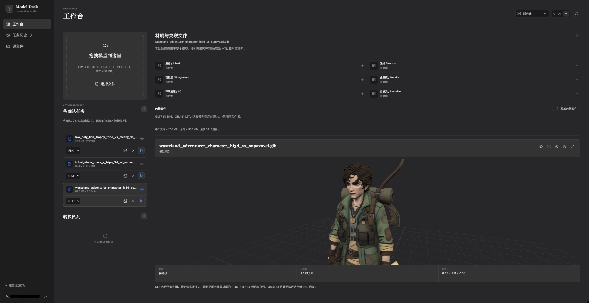
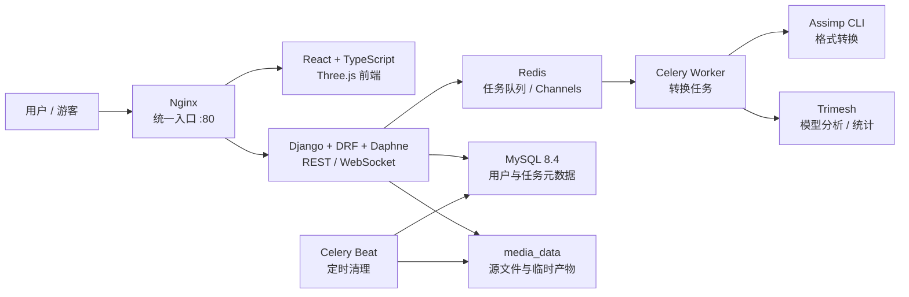
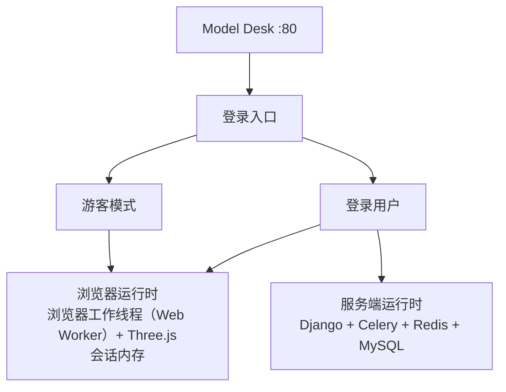
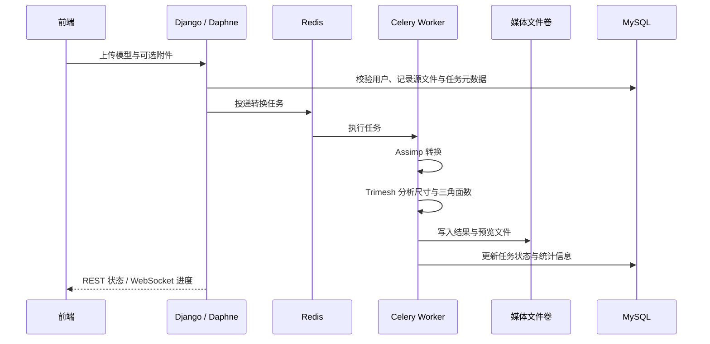

# Model Desk

Model Desk 是一个本地优先的 3D 模型转换与预览平台。项目将模型转换、格式
分析、任务进度、用户隔离和临时文件清理组合在同一个网页应用中，并通过统一
的 `80` 端口提供服务。

预览界面：


项目当前包含两种运行时：

- **服务端运行时**：面向登录用户，使用 Django、Celery、Redis 和 MySQL
  完成异步转换与持久化元数据管理。
- **浏览器运行时**：面向游客或希望本地处理的登录用户，在浏览器工作线程中
  使用 Three.js 完成受限格式转换；数据只存在于当前会话内，不写入数据库、
  `localStorage`、IndexedDB 或服务工作线程缓存。

## 项目概述

### 核心能力

- 支持 `GLB`、`GLTF`、`OBJ`、`STL`、`PLY`、`FBX` 模型格式。
- 服务端运行时支持上述格式作为输入和输出，但禁止转换为与源文件相同的格式。
- 服务端使用 Assimp 执行格式转换，使用 Trimesh 完成模型统计与分析。
- 通过 WebSocket 推送任务进度，REST API 作为状态恢复与管理接口。
- 按用户隔离源文件、转换任务和历史元数据。
- 源文件支持基于 SHA-256 的去重；相同用户的相同输入可复用已有源文件。
- 转换产物和预览文件只短期保留，成功任务的文件在 10 分钟后自动清理；
  转换任务元数据仍保留在数据库中。
- 浏览器运行时只保留当前页面会话数据，单个任务的模型与附件合计限制为
  `100 MiB`，结果不会长期占用浏览器缓存。

### 浏览器运行时的边界

浏览器运行时与服务端运行时共用同一个前端和入口地址，但处理链路彼此独立：

- 游客模式仅进入浏览器运行时。
- 浏览器运行时不依赖 Django API、WebSocket、Celery、Redis 或 MySQL。
- 浏览器端只开放已确认支持的转换能力；完整格式覆盖、任务历史和持久化
  数据管理属于服务端运行时。
- 浏览器会话结束、刷新页面或切换运行时后，会话数据被清除。

## 当前系统架构

### 总体架构

更多技术实现细节可以参考 [IMPL](IMPL.md)



### 两种运行时



### 服务端转换链路



### 容器服务

| 服务 | 作用 |
| --- | --- |
| `mysql` | MySQL 8.4，保存用户、源文件、转换任务和历史元数据 |
| `redis` | Celery 消息代理、任务状态与 Django Channels 通信 |
| `backend` | Django API、Daphne ASGI 服务、数据库迁移和 WebSocket |
| `worker` | Celery 异步转换进程，内含 Assimp 与 Trimesh |
| `cleanup` | Celery Beat 定时清理过期转换产物 |
| `frontend` | React/Vite 前端的生产构建与静态预览服务，内部端口 `4173` |
| `nginx` | 对外暴露 `80` 端口，并转发页面、`/api/`、`/ws/` 和 `/media/` |

Nginx 是唯一的公网入口。前端内部的 Vite 预览端口不会直接作为默认访问
入口暴露；浏览器运行时也不需要单独部署第二套前端。

### 代码结构

```text
.
├── backend/
│   ├── config/                 # Django、ASGI、Celery、环境配置
│   ├── converter/              # 模型、API、转换逻辑、任务与生命周期
│   ├── manage.py
│   ├── requirements.txt
│   └── Dockerfile
├── frontend/
│   ├── src/                   # React 页面、预览器、运行时与 API
│   ├── package.json
│   └── Dockerfile
├── nginx/
│   └── nginx.conf             # 统一入口与反向代理规则
├── docs/
│   └── workspace.png          # 工作台预览截图
├── docker-compose.yml         # 本地完整运行时编排
├── IMPL.md                    # 技术实现与组件职责
└── README.md
```

## 安装方法

### 前置条件

- Docker Desktop，或支持 Compose v2 的 Docker 引擎。
- 可用的 Docker Compose v2 命令：`docker compose`。
- 主机的 `80` 端口未被其他服务占用。
- 足够的磁盘和内存用于 MySQL、Redis 以及 3D 模型转换。

### 使用 Docker Compose 安装并启动

在项目根目录执行：

```bash
docker compose up --build
```

首次启动会构建前端和后端镜像，并创建 `mysql_data`、`media_data` 两个
持久化卷。后端容器会在启动时执行数据库迁移，随后由 Nginx 统一提供访问
入口：

```text
http://localhost
```

### 前端本地开发依赖（可选）

如果只需要安装前端开发依赖，可在 `frontend/` 目录执行：

```bash
npm ci
```

生产部署仍以项目根目录的 Docker Compose 编排为准；前端本地开发服务不
替代完整的服务端运行时。

## 持久化与清理边界

```text
持久化：
  MySQL       用户、源文件索引、任务历史、转换元数据
  media_data  源文件及转换期间需要的文件

临时：
  转换产物、预览文件      成功后保留 10 分钟，随后由 cleanup 清理
  浏览器运行时数据        仅当前会话内存，刷新/离开/切换运行时即清除
```
